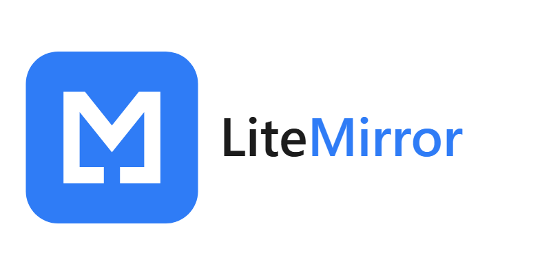
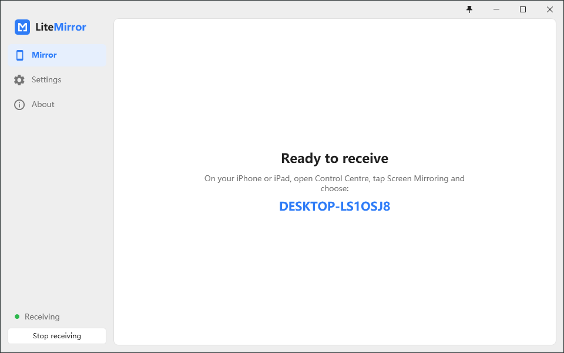

<p align="center">
  <picture>
    <source media="(prefers-color-scheme: dark)" srcset="assets/logo-dark.png">
    
  </picture>
</p>

**An AirPlay receiver for Windows in five files.**

<p align="center">
  <a href="LICENSE"></a>
  
  
  
  <a href="README.zh-CN.md"></a>
</p>

Open Screen Mirroring on an iPhone or iPad, pick the PC, and the phone's screen and sound arrive in a window that takes the phone's shape. The phone needs nothing installed. The PC gets a 3 MB installer that puts down five files: no Bonjour, no VC++ redistributable, nothing running in the background that you did not start.

<p align="center">
  <picture>
    <source media="(prefers-color-scheme: dark)" srcset="assets/screenshot-en-dark.png">
    
  </picture>
</p>

## ✨ Highlights

- Screen mirroring with audio from any iPhone or iPad on the same network
- H.264 decoded on the GPU through Media Foundation and D3D11, with a software fallback for broken drivers
- Low latency by default: the decoder runs in AVLowLatencyMode and frames are presented without waiting for vsync; an optional Catmull-Rom bicubic upscaler when the window is larger than the picture
- The window keeps the phone's aspect ratio and turns with it; F11 goes full screen on the monitor you choose; a pin keeps it on top
- A PIN, either a fresh 4-digit code shown on the PC for every connection or a fixed one; when a second phone connects you are asked whether to replace the first or refuse it
- Colour controls on the video processor: BT.601/BT.709 matrix, limited or full range, brightness, contrast, saturation, hue
- Any audio output device; the phone's volume buttons set the app's volume in the Windows mixer
- An overlay with resolution, frame rate, per-frame processing time and decoder
- Light and dark themes, six accent colours, English and Chinese; runs in the tray, optionally at sign-in
- Works without a router: over the PC's own mobile hotspot, which a switch in the settings turns on, a phone's personal hotspot, or USB tethering

## 📦 Install

Download `LiteMirror-<version>-setup.exe` from the [releases page](https://github.com/Cedr1cSun/litemirror/releases) and run it. Windows 10 version 1809 or later, 64-bit; .NET Framework 4.8, which Windows 10 1903 and later and Windows 11 include. The installer puts the program under `Program Files`, adds a Start menu entry and an inbound firewall rule limited to the local subnet, and removes all of it on uninstall. Settings live in `%AppData%\LiteMirror` and survive an uninstall.

The installer is not code signed yet, so SmartScreen shows an unknown publisher warning the first time.

The About page checks GitHub for a newer release when you ask, or at every start if you switch that on in the settings. It only reads the latest release tag; you download and run the new installer yourself, and it upgrades in place.

## 🚀 Quick start

1. Start LiteMirror and press **Start receiving** (Ctrl+R), or switch on automatic start in the settings.
2. On the phone, open Control Centre, tap **Screen Mirroring** and choose the PC. It is listed under the receiver name from the settings, which is the computer name unless you change it.
3. Stop from the phone, or press Ctrl+R to stop receiving.

| key | action |
|---|---|
| F11 | full screen, Esc leaves it |
| Ctrl+F | resize the window to fit the picture |
| Ctrl+I | show or hide the picture information |
| Ctrl+R | start or stop receiving |

Every setting carries a line underneath that says what it changes and when to change it.

## 📶 Without a router

The phone and the PC only need an IP link between them; the mDNS announcement and the streams go over whatever that is. Three links that leave the router out:

| link | how |
|---|---|
| PC hotspot | Settings, **Windows mobile hotspot**. The name and password appear under the switch; join from the phone. Windows needs a Wi-Fi adapter and an existing connection it can share. |
| phone hotspot | Turn on Personal Hotspot on the phone and join it from the PC. The PC's Internet goes through the phone meanwhile. |
| USB | Connect the cable and turn on Personal Hotspot. The PC needs Apple's USB network driver, which iTunes or the Apple Devices app installs; a network adapter appears and AirPlay runs over it. |

Windows files these links under the public profile. The installer's firewall rule allows every profile but only the local subnet, so they work out of the box. A build run from `build\bin` gets the Windows firewall prompt instead: tick public networks there.

## 🧩 How it works

1. **Announce.** The core registers `_airplay._tcp` and `_raop._tcp` through `DnsServiceRegister` in Windows' own `dnsapi.dll`, which is why 1809 is the floor and Bonjour is not needed.
2. **Pair and stream.** RTSP and HTTP servers handle pairing, the FairPlay handshake and SETUP, then the mirror stream and the RTP audio stream come in. PIN is Digest authentication at SETUP; a refused second phone gets a 453.
3. **Decode and show.** H.264 goes through a Media Foundation transform into D3D11 textures; the video processor converts colour and applies the filters; the swap chain presents into a Win32 child window inside the WPF shell. AAC goes through FDK to WASAPI.

Three layers, each only talking to the one below: a protocol core in C (`litemirror-core.lib`), a C++ layer with decoding, rendering, audio and the public C API (`litemirror.dll`, `include/litemirror.h`), and a WPF shell that reaches the DLL through P/Invoke alone. The DLL can be used on its own; `src/demo/` shows it under SDL2.

## 🔧 Build from source

Visual Studio 2022 Build Tools with the C++ workload (v143) and the .NET SDK 8; the shell references `Windows.winmd` from the Windows SDK the workload brings, for the hotspot switch. The integration tests want Python 3 with `pip install -r tests\integration\requirements.txt`; the installer wants Inno Setup 6 (`winget install JRSoftware.InnoSetup`).

```
.\build.ps1                           # Debug x64 into build\bin\Debug
.\build.ps1 -Config Release -Test     # build, then unit, app and integration tests
.\build.ps1 -Config Release -Package  # build\LiteMirror-<version>-setup.exe
```

Build through `build.ps1` or the solution, never one project on its own: include paths use `$(SolutionDir)`. x64 only.

| path | what it is |
|---|---|
| `src/core/` | protocol core in C: RTSP and HTTP servers, pairing, FairPlay, RTP audio and mirror streams, AAC, mDNS |
| `src/sdk/` | C++ layer: H.264 decoding, D3D11 rendering, WASAPI audio, the public C API |
| `src/app/LiteMirror/` | the WPF shell, .NET Framework 4.8 and HandyControl |
| `src/testhost/` | console host that the integration tests drive |
| `src/demo/` | SDL2 demo of the DLL, kept as a test tool |
| `tests/unit/` | doctest tests of the core and the SDK |
| `tests/app/` | xunit tests of the shell's pure logic: window shape, settings file |
| `tests/integration/` | Python suite over mDNS and RTSP, up to pair-verify |
| `installer/` | Inno Setup script |
| `third_party/` | vendored sources, listed under Licence |

## 🧪 Testing

`build.ps1 -Test` runs the doctest suite against the core and the SDK (decoder, video sink, audio sink, channel, the C API), the xunit tests of the shell's logic, then the Python suite, which browses the mDNS announcement, pairs with the test host and opens a session the way a phone does, including the PIN and second-device flows with two scripted phones. Everything after the FairPlay handshake needs a real iOS device, so that part is checked by hand.

## 🗺️ Scope

- Windows 10 1809 and later, x64. An older Windows has no `DnsServiceRegister`; the app says so instead of failing to start.
- Receiving only. LiteMirror does not send a screen anywhere.
- One phone at a time. A second phone replaces the first or is refused, by your choice.
- While the second-device dialog is open the phone that asked waits; it is refused after 15 seconds without an answer.

## 📄 Licence

[GPL-3.0-or-later](LICENSE). LiteMirror started from [airplay2-win](https://github.com/fingergit/airplay2-win) by fingergit (MIT), which ported AirplayServer and shairplay to Windows; [UxPlay](https://github.com/FDH2/UxPlay) is the reference when the protocol needs a fix. Bundled code keeps its own licence:

| component | licence |
|---|---|
| shairplay / AirplayServer protocol core | MIT |
| playfair (FairPlay handshake) | GPL-3.0 |
| Fraunhofer FDK AAC decoder | FDK AAC Codec Library licence |
| libplist | LGPL-2.1-or-later |
| ed25519 (Orson Peters) | zlib |
| curve25519-donna | BSD-3-Clause |
| axTLS crypto | BSD-3-Clause |
| http_parser | MIT |
| doctest | MIT |
| SDL2, demo only | zlib |
| HandyControl | MIT |
| Material Design Icons | Apache-2.0 |
