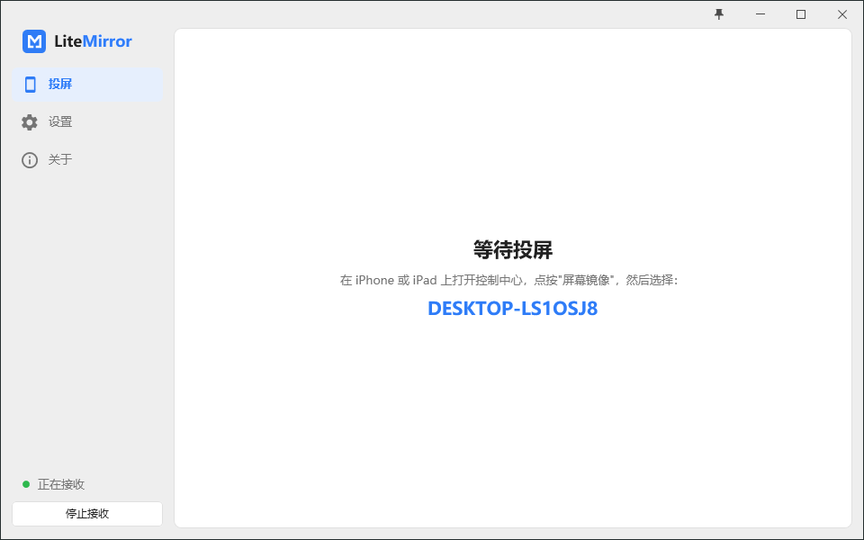

<p align="center">
  <picture>
    <source media="(prefers-color-scheme: dark)" srcset="assets/logo-dark.png">
    
  </picture>
</p>

**五个文件的 Windows AirPlay 接收端。**

<p align="center">
  <a href="LICENSE"></a>
  
  
  
  <a href="README.md"></a>
</p>

在 iPhone 或 iPad 上打开屏幕镜像，选这台电脑，手机的画面和声音就出现在一个跟手机同样形状的窗口里。手机上什么都不用装。电脑这边是一个 3 MB 的安装包，装下五个文件：不要 Bonjour，不要 VC++ 运行库，没有你没启动的后台进程。

<p align="center">
  <picture>
    <source media="(prefers-color-scheme: dark)" srcset="assets/screenshot-zh-dark.png">
    
  </picture>
</p>

## ✨ 功能

- 同一网络下任何 iPhone、iPad 的屏幕镜像，带声音
- H.264 通过 Media Foundation 和 D3D11 在 GPU 上解码，驱动有问题时可退回软件解码
- 默认低延迟：解码器跑在 AVLowLatencyMode，帧一到就呈现，不等垂直同步；窗口比画面大时可选 Catmull-Rom 双三次放大
- 窗口保持手机的宽高比并跟着旋转；F11 在你指定的显示器上全屏；图钉按钮置顶
- PIN：每次连接在电脑上显示一个新的 4 位码，或者固定一个；第二台手机来连时问你是替换还是拒绝
- 视频处理器上的色彩调节：BT.601/BT.709 矩阵、有限或完整范围、亮度、对比度、饱和度、色相
- 任意音频输出设备；手机的音量键直接调本程序在 Windows 混音器里的音量
- 叠加层显示分辨率、帧率、每帧处理耗时和解码方式
- 浅色和深色主题，六种强调色，中英文；可缩到托盘，可登录时启动
- 不靠路由器也能连：电脑自己的移动热点、手机个人热点，或 USB 共享网络

## 📦 安装

从[发布页](https://github.com/Cedr1cSun/litemirror/releases)下载 `LiteMirror-<版本>-setup.exe` 运行。要求 Windows 10 1809 或更新、64 位，以及 .NET Framework 4.8（Windows 10 1903 之后和 Windows 11 自带）。安装程序把程序放到 `Program Files`，添加开始菜单项和一条只放行本地子网的入站防火墙规则，卸载时全部删除。设置在 `%AppData%\LiteMirror`，卸载后保留。

安装包还没有签名，第一次运行时 SmartScreen 会提示"未知发布者"。

关于页可以查 GitHub 上有没有新版本，设置里打开后每次启动也会查一次。它只读最新 Release 的标签；新安装包由你自己下载运行，原地覆盖升级。

## 🚀 快速开始

1. 打开 LiteMirror，点**开始接收**（Ctrl+R），或在设置里打开自动接收。
2. 手机打开控制中心，点**屏幕镜像**，选这台电脑。列表里显示的是设置里的接收端名称，不改就是电脑名。
3. 在手机上停止，或按 Ctrl+R 停止接收。

| 按键 | 作用 |
|---|---|
| F11 | 全屏，Esc 退出 |
| Ctrl+F | 窗口贴合画面 |
| Ctrl+I | 显示或隐藏画面信息 |
| Ctrl+R | 开始或停止接收 |

每个设置项下面都有一行说明，讲它改的是什么、什么时候该改。

## 📶 不经过路由器

手机和电脑之间只要有一条 IP 链路，mDNS 广播和音视频流就走这条链路。三种绕开路由器的接法：

| 链路 | 做法 |
|---|---|
| 电脑热点 | 在 Windows 设置里打开移动热点（LiteMirror 设置里的“热点”一行有按钮直达该页），手机连上即可。Windows 要求电脑有 Wi-Fi 网卡，并且已有一条可共享的连接。 |
| 手机热点 | 手机打开个人热点，电脑连上去。期间电脑上网走手机流量。 |
| USB | 插上数据线，手机打开个人热点。电脑需要 Apple 的 USB 网络驱动（iTunes 或 Apple Devices 应用自带），之后多出一个网络适配器，AirPlay 走它。 |

这些链路在 Windows 里都算公用网络。安装包加的防火墙规则放行所有配置文件但只限本地子网，所以装完直接能用。从 `build\bin` 直接运行的构建会弹 Windows 防火墙提示，勾上公用网络即可。

## 🧩 工作原理

1. **广播。** 核心通过 Windows 自带 `dnsapi.dll` 的 `DnsServiceRegister` 注册 `_airplay._tcp` 和 `_raop._tcp`，所以最低要 1809，也不需要 Bonjour。
2. **配对和推流。** RTSP 和 HTTP 服务处理配对、FairPlay 握手和 SETUP，然后镜像流和 RTP 音频流进来。PIN 是 SETUP 阶段的 Digest 认证；被拒绝的第二台手机收到 453。
3. **解码和显示。** H.264 经 Media Foundation 变换进 D3D11 纹理，视频处理器做颜色转换和滤镜，交换链呈现到 WPF 界面里的一个 Win32 子窗口。AAC 经 FDK 解码后走 WASAPI。

三层，每层只跟下一层说话：C 语言协议核心（`litemirror-core.lib`）、带解码、渲染、音频和公开 C API 的 C++ 层（`litemirror.dll`，`include/litemirror.h`）、只通过 P/Invoke 调 DLL 的 WPF 界面。DLL 可以单独使用，`src/demo/` 是它在 SDL2 下的演示。

## 🔧 从源码构建

Visual Studio 2022 Build Tools 的 C++ 工作负载（v143）和 .NET SDK 8。集成测试需要 Python 3 并 `pip install -r tests\integration\requirements.txt`；打安装包需要 Inno Setup 6（`winget install JRSoftware.InnoSetup`）。

```
.\build.ps1                           # Debug x64，输出到 build\bin\Debug
.\build.ps1 -Config Release -Test     # 构建，然后跑单元、应用、集成测试
.\build.ps1 -Config Release -Package  # 生成 build\LiteMirror-<版本>-setup.exe
```

通过 `build.ps1` 或解决方案构建，不要单独构建某个工程：包含路径用了 `$(SolutionDir)`。只支持 x64。

| 路径 | 内容 |
|---|---|
| `src/core/` | C 语言协议核心：RTSP 和 HTTP 服务、配对、FairPlay、RTP 音频和镜像流、AAC、mDNS |
| `src/sdk/` | C++ 层：H.264 解码、D3D11 渲染、WASAPI 音频、公开 C API |
| `src/app/LiteMirror/` | WPF 界面，.NET Framework 4.8 和 HandyControl |
| `src/testhost/` | 集成测试驱动的控制台宿主 |
| `src/demo/` | DLL 的 SDL2 演示程序，留作测试工具 |
| `tests/unit/` | 核心和 SDK 的 doctest 测试 |
| `tests/app/` | 界面纯逻辑的 xunit 测试：窗口尺寸、设置文件 |
| `tests/integration/` | 走 mDNS 和 RTSP 的 Python 套件，一直到 pair-verify |
| `installer/` | Inno Setup 脚本 |
| `third_party/` | 内置的第三方源码，见许可证一节 |

## 🧪 测试

`build.ps1 -Test` 先跑核心和 SDK 的 doctest（解码器、视频输出、音频输出、通道、C API），再跑界面逻辑的 xunit 测试，然后是 Python 套件：浏览 mDNS 广播、和测试宿主配对、像手机一样开会话，包括 PIN 和两台脚本手机的第二设备流程。FairPlay 握手之后的部分需要真实 iOS 设备，靠手工验证。

## 🗺️ 范围

- Windows 10 1809 及以后，x64。更老的 Windows 没有 `DnsServiceRegister`，程序会直接说明，不会启动失败。
- 只接收。LiteMirror 不往外投屏。
- 一次一台手机。第二台来了替换第一台或被拒绝，由你定。
- 第二设备弹窗开着时，发起连接的手机在等；15 秒没回答就按拒绝处理。

## 📄 许可证

[GPL-3.0-or-later](LICENSE)。LiteMirror 起源于 fingergit 的 [airplay2-win](https://github.com/fingergit/airplay2-win)（MIT），它把 AirplayServer 和 shairplay 移植到了 Windows；协议需要修正时以 [UxPlay](https://github.com/FDH2/UxPlay) 为参考。内置代码保留各自的许可证：

| 组件 | 许可证 |
|---|---|
| shairplay / AirplayServer 协议核心 | MIT |
| playfair（FairPlay 握手） | GPL-3.0 |
| Fraunhofer FDK AAC 解码器 | FDK AAC Codec Library 许可证 |
| libplist | LGPL-2.1-or-later |
| ed25519（Orson Peters） | zlib |
| curve25519-donna | BSD-3-Clause |
| axTLS crypto | BSD-3-Clause |
| http_parser | MIT |
| doctest | MIT |
| SDL2，仅演示程序 | zlib |
| HandyControl | MIT |
| Material Design Icons | Apache-2.0 |
